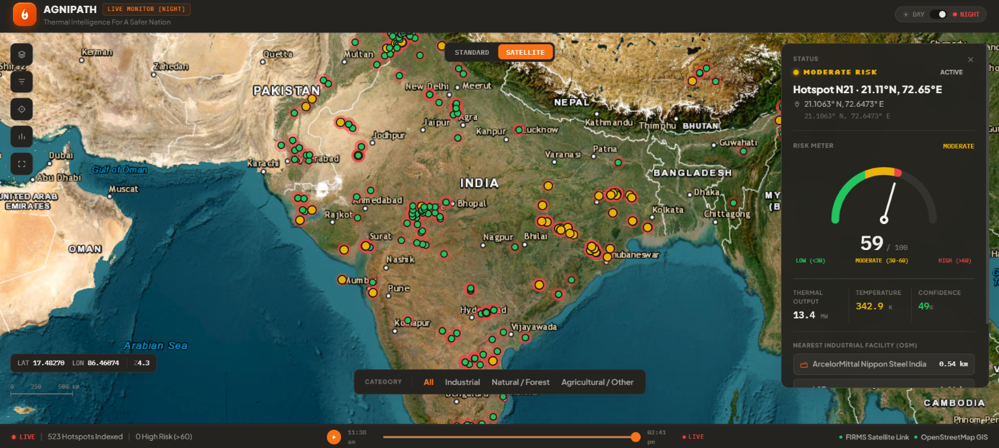
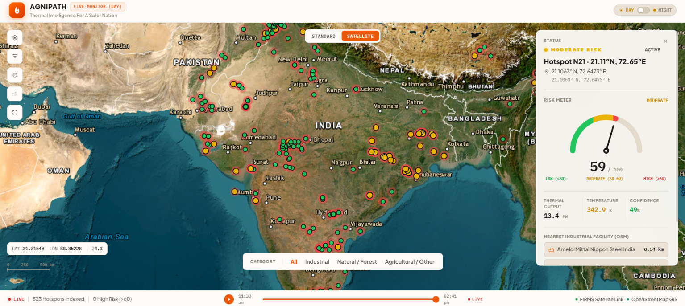
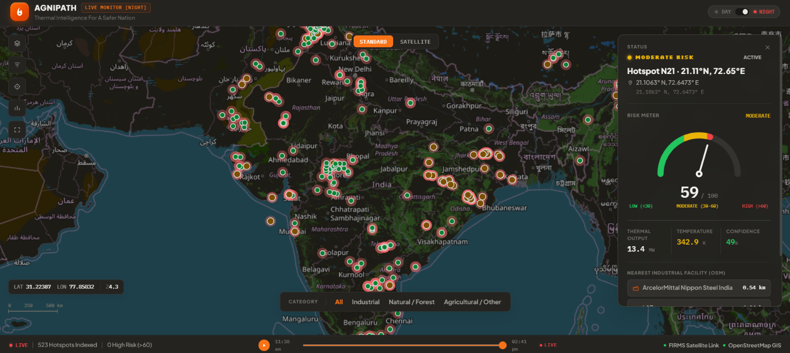
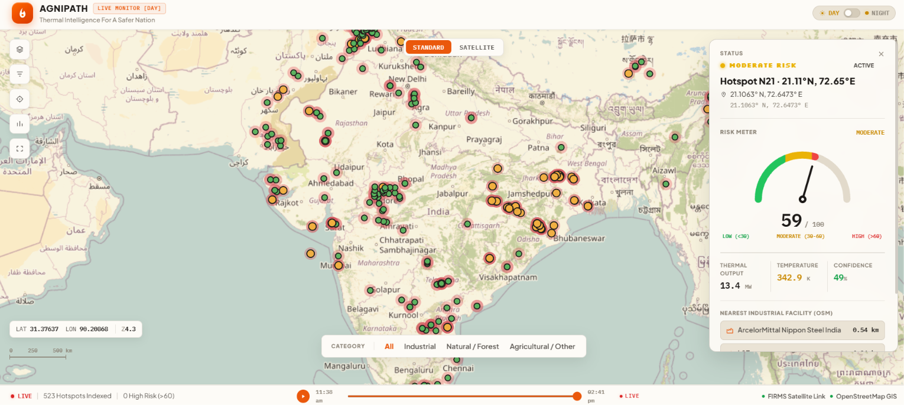
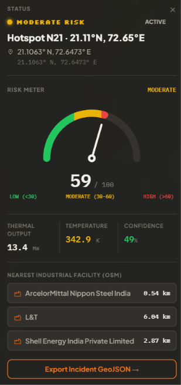

 <div align="center">

# 🔥 AGNIPATH

### AI-Based Detection & Classification of Industrial Fires & Persistent Thermal Sources

[](https://fastapi.tiangolo.com)
[](https://www.python.org/)
[](https://maplibre.org/)
[](LICENSE)

**A high-precision geospatial surveillance platform developed for Smart India Hackathon (SIH 2024 / Problem SIH26162) to detect, classify, and track industrial thermal anomalies, flare emissions, and fire hazards in near-real-time.**

[Key Features](#-key-features) • [Interface Preview](#-interface-preview) • [Architecture](#-architecture) • [Getting Started](#-getting-started) • [API Reference](#-api-reference)

</div>

---

## 📌 Problem Statement & Overview

Industrial sites, refineries, and chemical corridors present high-consequence thermal risks that can go unnoticed until they escalate.

**AGNIPATH** aims to automate spatial threat detection by processing NASA FIRMS active fire telemetry from VIIRS and MODIS sensors and applying machine learning-based classification to distinguish routine industrial thermal sources from potentially hazardous anomalies.

The platform combines satellite-derived thermal data, risk scoring, geospatial visualization, and industrial proximity analysis to support faster incident assessment and disaster management.

## ✨ Key Features

- **Live Telemetry Indexing:** Ingests and processes satellite sensor readings across the Indian subcontinent.
- **Risk Index Scoring:** Computes risk scores from 0–100 using sensor confidence, surface temperature (K), and thermal radiative power (MW).
- **Multi-Layer Geospatial Mapping:** Switches between satellite imagery and OpenStreetMap (OSM) basemaps.
- **Day/Night Tactical UI:** Provides visualization modes optimized for daytime visibility and low-light operation.
- **Industrial Proximity Auditing:** Identifies nearby critical infrastructure, including facilities associated with ArcelorMittal, Shell, and L&T, to assess proximity-related risks.
- **GeoJSON Incident Export:** Supports spatial data export for incident reporting and disaster management workflows.

## 🖼️ Interface Preview

### Geospatial Tactical Views

| Satellite View — Night Mode | Satellite View — Day Mode |
|:---:|:---:|
|  |  |

| Standard OSM View — Night Mode | Standard OSM View — Day Mode |
|:---:|:---:|
|  |  |

### Thermal Diagnostics & Facility Proximity

The diagnostics interface provides detailed information about detected hotspots, including localized thermal output, surface temperature, detection confidence, and nearby industrial facilities.

<div align="center">
  
</div>

## 🏗️ Architecture

AGNIPATH integrates satellite telemetry ingestion, spatial processing, backend APIs, industrial proximity analysis, and an interactive geospatial dashboard.

```text
NASA FIRMS (VIIRS / MODIS Feeds)
              |
              v
   Spatial Parser & ML Filter
              |
              v
   FastAPI Backend (Port 8000)
              |
       +------+------+
       |             |
       v             v
OSM Spatial      Hotspot & Risk
Facility Buffers   API Endpoints
       |             |
       +------+------+
              |
              v
 MapLibre GL Tactical Dashboard
          (Port 5500)
```

## 🚀 Getting Started

Follow these steps to set up and run AGNIPATH locally.

### 1. Prerequisites

Ensure you have the following installed:

- Python 3.11 or later (Python 3.13 supported)
- Git
- Visual Studio Code (recommended)
- VS Code Live Server extension or Python's built-in HTTP server

### 2. Clone the Repository

```powershell
git clone https://github.com/zencloser/SIH26162.git
cd SIH26162
```

### 3. Backend Setup

Open a terminal in the project root and execute:

```powershell
cd backend

python -m venv venv
.\venv\Scripts\Activate.ps1

python -m pip install --upgrade pip
pip install -r requirements.txt

uvicorn main:app --reload --port 8000
```

The FastAPI backend should now be available at:

- **API Base URL:** http://localhost:8000
- **Interactive API Documentation:** http://localhost:8000/docs

> **Note:** If PowerShell blocks virtual environment activation, consult the Python documentation or use a terminal configured to allow script execution. The commands above assume Windows.

### 4. Frontend Setup

Open a **second terminal** in VS Code and run:

```powershell
cd frontend
python -m http.server 5500
```

Open the frontend in your browser:

**http://localhost:5500**

Keep both terminal sessions running while using the application.

## 📑 API Reference

| Endpoint | Method | Description |
|---|:---:|---|
| `/api/v1/hotspots` | `GET` | Retrieves detected thermal anomalies |
| `/api/v1/hotspots/{id}` | `GET` | Returns detailed hotspot telemetry and proximity information |
| `/api/v1/analytics/summary` | `GET` | Provides aggregate hotspot counts and regional risk distribution |

For the complete interactive API specification, visit `http://localhost:8000/docs` after starting the backend.

## 📁 Project Structure

```text
SIH26162/
├── backend/
│   ├── main.py
│   └── requirements.txt
├── frontend/
├── assests/
│   └── Screenshots/
│       ├── agnipath-satellite-night.png
│       ├── agnipath-satellite-day.png
│       ├── agnipath-standard-night.png
│       ├── agnipath-standard-day.png
│       └── agnipath-hotspot-diagnostics.png
├── README.md
└── LICENSE
```

> This is an illustrative structure based on the paths referenced in this README. Adjust it if your actual repository contains additional files or directories.

## 📜 License

This project is licensed under the MIT License. See the [LICENSE](LICENSE) file for details.

---

<div align="center">

**AGNIPATH — Turning Satellite Thermal Data into Actionable Geospatial Intelligence.**

</div>